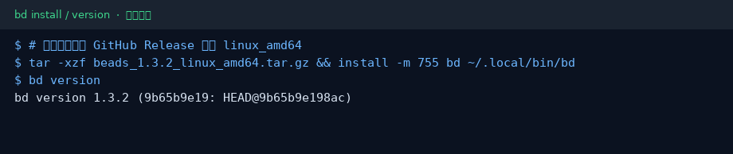
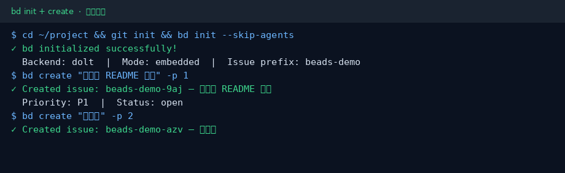
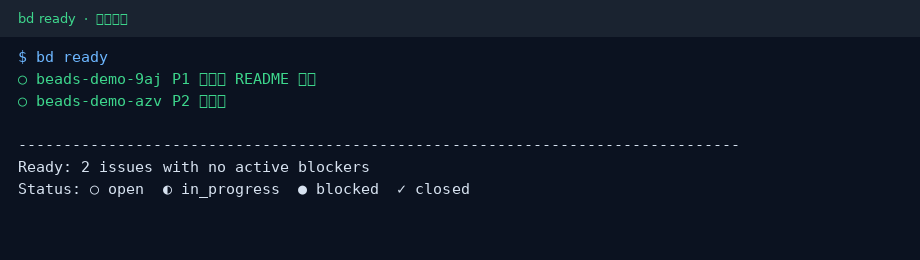

# Beads（bd）小白中文教程

> 给 AI coding agent 用的依赖感知任务图 / 记忆层（社区非官方教程）  
> 上游：[`gastownhall/beads`](https://github.com/gastownhall/beads)（历史路径 `steveyegge/beads`）· 文档：[beads.gascity.com](https://beads.gascity.com/)  
> 教程校对：2026-10-30（Asia/Shanghai）· 本机实测 **bd 1.3.2**（linux_amd64 Release）

[](https://github.com/xianyu110/awesome-beads-zh)
[](https://github.com/gastownhall/beads)
[](LICENSE)
[](https://xianyu110.github.io/awesome-beads-zh/)

---

## 截图索引

| # | 文件 | 类型 | 说明 |
|---|------|------|------|
| 1 | [`images/01-install.png`](images/01-install.png) | **真实** | 安装 `bd` 并 `bd version` → 1.3.2 |
| 2 | [`images/02-init-create.png`](images/02-init-create.png) | **真实** | `bd init --skip-agents` + `bd create` |
| 3 | [`images/03-ready.png`](images/03-ready.png) | **真实** | `bd ready` 列出无阻塞任务 |

> 真实截图在 Linux x86_64 沙盒采集；路径与 issue 前缀已脱敏。后端为官方默认的 **Dolt embedded**。

---

## 这是什么？

**Beads**（命令行 `bd`）把「给 agent 用的待办」做成**带依赖的图**，底层用 [Dolt](https://github.com/dolthub/dolt) 做可合并的版本化存储，避免多 agent / 多分支抢同一条 markdown TODO 时的冲突。

典型用法：

1. `bd create` 建任务（bead）
2. `bd dep add` 挂依赖
3. `bd ready` 拿「当前可认领、无阻塞」的任务
4. `bd update <id> --claim` → 做完 `bd close`

本仓库只提供**中文小白教程**（MIT），不二次分发上游二进制。上游许可证为 **MIT**。

---

## 官方链接（请以官方为准）

| 资源 | 链接 |
|------|------|
| 源码 | https://github.com/gastownhall/beads |
| 文档站 | https://beads.gascity.com/ |
| 安装说明 | https://github.com/gastownhall/beads/blob/main/docs/getting-started/installation.md |
| npm `@beads/bd` | https://www.npmjs.com/package/@beads/bd |
| PyPI `beads-mcp` | https://pypi.org/project/beads-mcp/ |

---

## 环境要求（摘要）

- **macOS / Linux / Windows / FreeBSD**
- 本教程推荐：官方 **install.sh** 或 **GitHub Release** 二进制；macOS/Linux 也可用 `brew install beads`
- 可选：把 `bd` 接到 Claude Code / Codex / Cursor 等（`bd setup …`），入门可先 `--skip-agents`

---

## 安装（macOS / Windows / Linux）

### 方式 A：官方一键脚本（推荐）

```bash
curl -fsSL https://raw.githubusercontent.com/gastownhall/beads/main/scripts/install.sh | bash
bd version
```

### 方式 B：Homebrew / npm

```bash
brew install beads           # macOS / Linux
# 或
npm install -g @beads/bd
```

### 方式 C：Release 二进制（本教程实测）

到 [Releases](https://github.com/gastownhall/beads/releases) 下载对应平台包（如 `beads_*_linux_amd64.tar.gz`），解压后把 `bd` 放到 `PATH`：

```bash
tar -xzf beads_*_linux_amd64.tar.gz
install -m 755 bd ~/.local/bin/bd   # 确保 ~/.local/bin 在 PATH
bd version
```



Windows 安装与杀软误报说明见官方 [installation.md](https://github.com/gastownhall/beads/blob/main/docs/getting-started/installation.md) 与 [antivirus.md](https://github.com/gastownhall/beads/blob/main/docs/reference/antivirus.md)。

---

## 第一次演示任务（约 5 分钟）

在**你自己的项目目录**里初始化（不要把 beads 源码仓 clone 进业务项目当依赖）：

```bash
cd your-project
git init   # 若尚无仓库；已有 git 可跳过
bd init --skip-agents   # 跳过向导式 agent 集成，先学会核心命令
```

创建两条任务并查看可认领列表：

```bash
bd create "写中文 README 草稿" -p 1
bd create "补截图" -p 2
bd ready
```





认领与关闭（示意）：

```bash
bd update <id> --claim
# … agent 或你本人完成工作 …
bd close <id>
```

需要给 agent 注入工作流说明时，再运行例如：

```bash
bd setup --list
# bd setup claude / bd setup codex / bd setup cursor …
```

或按官方 README 把 `bd onboard` 打印的片段贴进你的 `AGENTS.md`。

---

## 常见报错与解决

| 现象 | 可能原因 | 处理 |
|------|----------|------|
| `bd: command not found` | 未进 PATH | 把安装目录加入 PATH，或重开终端 |
| `bd init` 提示已初始化 | 目录里已有 beads 数据 | 换目录，或阅读官方文档中的 reset / stealth 说明 |
| 多机不同步 | 未配置 Dolt remote | 见官方 `bd dolt push/pull` 相关文档 |
| Windows 杀软拦截 | 误报 | 见官方 antivirus 文档，核对 Release 校验和 |

命令与菜单名以你本机 `bd --help` / 官方文档为准，本教程不编造子命令。

---

## 许可证与合规

- **本教程文字与配图**：MIT（见 [LICENSE](LICENSE)）
- **上游 Beads**：MIT；运行时会使用 **Dolt** 等依赖，请自行阅读其许可证
- 本教程**不硬推**未备案境外模型或 API 中转。若用 `bd setup` 对接 coding agent，优先使用你**已有**的本地 / 国内兼容 CLI（如 DeepSeek、Ollama、已备案服务）；可选引擎以官方 `bd setup --list` 为准
- 可选软链（非必须）：若你需要统一试多家模型 API，可自行了解 [tryallapi.com](https://tryallapi.com/?aff=5A6A)（aff=5A6A）；店铺仅 [MaynorAI](https://wzyp.cn/shop/maynorai)

与 gastownhall / Dolt 官方**无隶属关系**。价格、配额、云服务条款以各官方页面为准。

---

## GitHub Pages

图文镜像页：https://xianyu110.github.io/awesome-beads-zh/
